# Fleet console

A web console for the cloud side of the gateway fleet:
- see every gateway and its health;
- add, update and remove IMSs (PPM packages);
- roll a package out to several gateways at once;
- change timers;
- pause telemetry;
- decommission a gateway.

It runs serverless in the same AWS account as the gateways. It never connects to a gateway:
every change is a Device Shadow update, which the gateway acts on by itself.

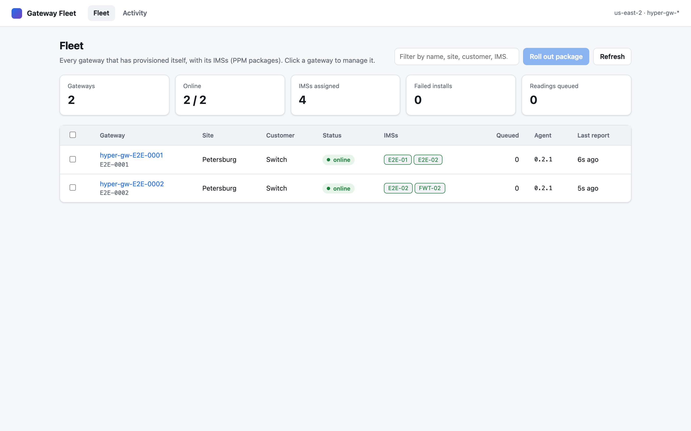

## How it fits together

```
browser ──HTTPS──▶ API Gateway (REST, IP allowlist) ──▶ console Lambda ──▶ IoT registry, Device Shadows,
   │                                                         │                S3 (packages), DynamoDB (audit)
   └──presigned PUT──▶ S3 uploads/ (same IP allowlist)       │
                                                             ▼
gateway ──MQTT hyper/<thing>/package/request──▶ IoT rule ──▶ package-server Lambda
gateway ◀─MQTT hyper/<thing>/package/chunk─────────────────── (reads packages/<thing>/…, sends 90 KB chunks)
```

* **Fleet**: every AWS IoT thing whose name starts with `hyper-gw-`. Status comes from the
  `gateway` shadow's health report (every 60 s). A gateway is offline if its last report is
  over 180 s old.
* **Adding or updating an IMS**:
  1. The browser uploads the HAMF export straight to S3.
  2. The console checks it with the same parser the gateway uses (`gateway_agent/hamf.py`).
  3. It stores the package at `packages/<thing>/ims-<key>/<sha256>`.
  4. It sets the `ims-<key>` shadow with `source: {"type": "mqtt"}` and adds the IMS to the `gateway` shadow's list.
* **Delivery**: the gateway asks for the package over MQTT, and the package-server Lambda
  sends it in chunks. The agent checks the SHA-256 before installing. Unlike a presigned URL,
  this never expires: a gateway that was offline for a week still gets its package. A gateway
  can only ever receive packages stored under its own thing name.
* **Audit**: every change is recorded in DynamoDB (action, gateway, details, source IP) and
  kept for 400 days.

## Sign-in and network

There is no sign-in yet. The API Gateway resource policy and the S3 upload policy accept only
the source IPs in `AllowedCidrs`. Every request that changes something must carry the header
`X-Console-Request: 1`. A cross-site form or image can't send that header, so a web page on
another site can't drive the console from a browser on an allowed network. The page is served
with a strict Content-Security-Policy (no inline script, no framing).

Before customers' gateways are managed from it, put company sign-in in front of it: a Cognito
or IAM Identity Center authorizer on the API, with read-only and operator roles.

## Deploying

First, set up the account's IoT side (once per account):

```bash
AWS_PROFILE=<profile> tools/aws_setup.sh
```

Then deploy the console, giving the allowed networks as comma-separated CIDRs:

```bash
AWS_PROFILE=<profile> console/deploy.sh 50.154.200.106/32
```

The script prints the console URL. Re-running it updates the stack in place.

To turn on HAMF pull, pass HAMF's API base URL as the second argument. AWS must be able to
reach HAMF at that URL:

```bash
AWS_PROFILE=<profile> console/deploy.sh 50.154.200.106/32 https://hamf.example.com/api
```

| Stack resource | What it is |
|---|---|
| `ConsoleApi` | Regional REST API, stage `console`, IP allowlist, 20 requests/s |
| `ConsoleFunction` | UI and API (`console/backend/console_api.py`) |
| `PackageServerFunction` | Sends packages to gateways (`console/backend/package_server.py`) |
| `PackageRequestRule` | IoT rule `hyper_package_request` on `hyper/+/package/request` |
| `PackageBucket` | `hyper-console-<account>-<region>`: `uploads/` (kept 2 days) and `packages/` |
| `AuditTable` | Console activity log (TTL 400 days) |

## Using it

### A gateway

Click a gateway in the fleet list to open its page, which shows:
- its IMSs, their install status and timers;
- its health report;
- its certificate;
- its activity;
- its raw shadows.

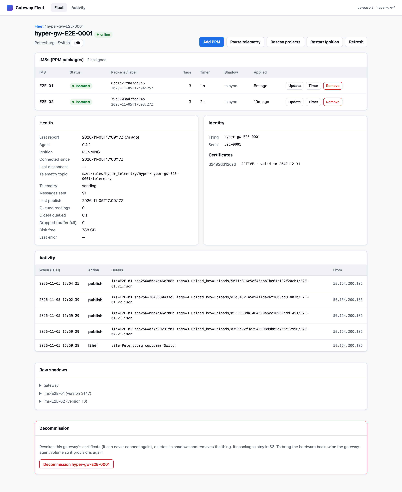

The real FWT-02 export, delivered through the console (3,901 tags, 2.7 MB, 31 MQTT chunks):

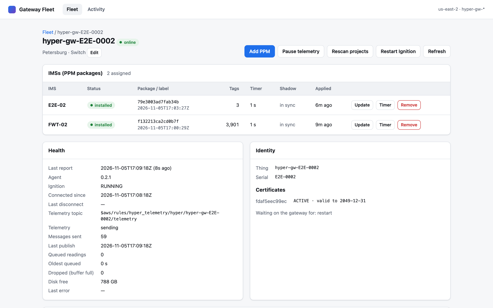

### Adding a PPM

Click **Add PPM** and drop in the HAMF export (`.json` or `.zip`, up to 16 MB). Or use
**From HAMF** to fetch it by asset id, once HAMF pull is on. The console validates the export
and shows the IMS, tag count, devices and tag folder before anything is sent.

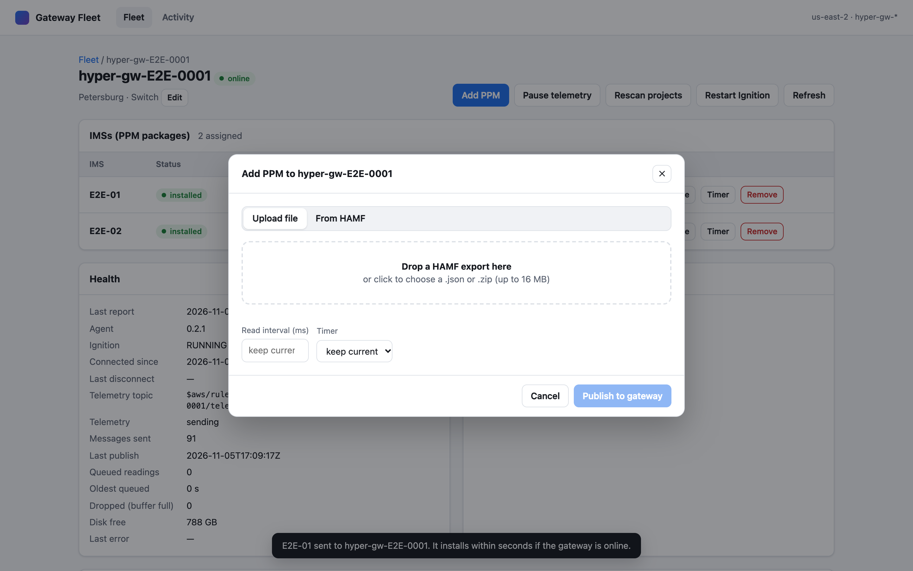
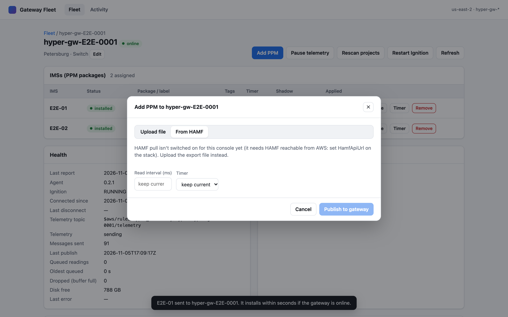

### Updating a PPM

Click **Update** on an IMS. The preview compares the new export with the package the gateway
has now: tags added, tags deleted, tags moved, and devices added or dropped. That way a tag
deletion is never a surprise.

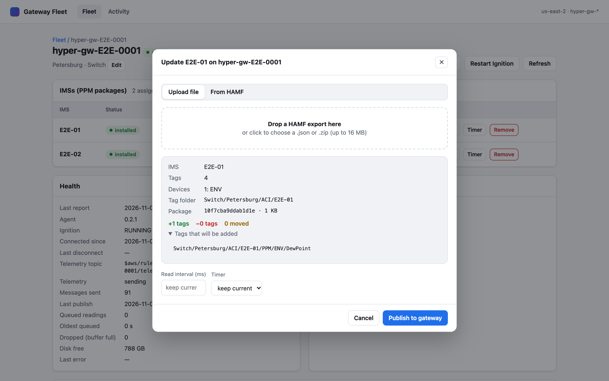

After **Publish**, the gateway downloads, checks and installs the package within seconds if
it's online, or when it next connects.

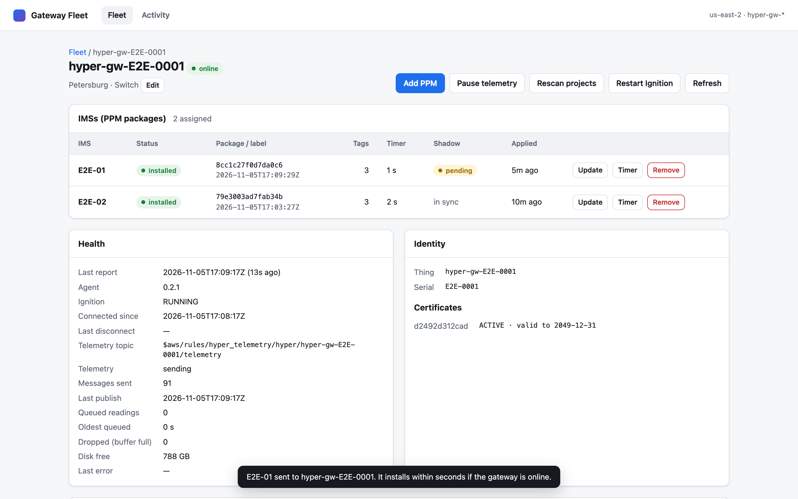

### Timer, retry, remove

* **Timer**: changes the read interval, or turns the timer (and that IMS's telemetry) off,
  without reinstalling the package.
* **Retry**: appears on a failed install, and asks the gateway to try again.
* **Remove**: deletes the IMS's tags and timer from the gateway.

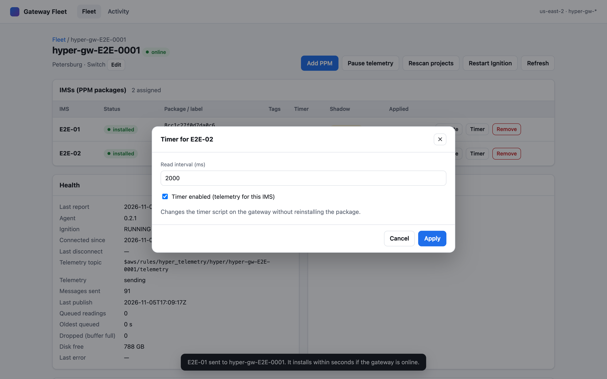

### Rolling out to several gateways

Tick gateways in the fleet list, then click **Roll out package to N**. One upload goes to every
selected gateway. If a gateway fails, it's listed, and the rest still get the package.

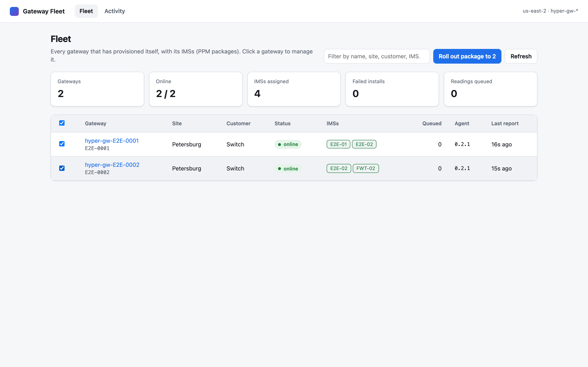
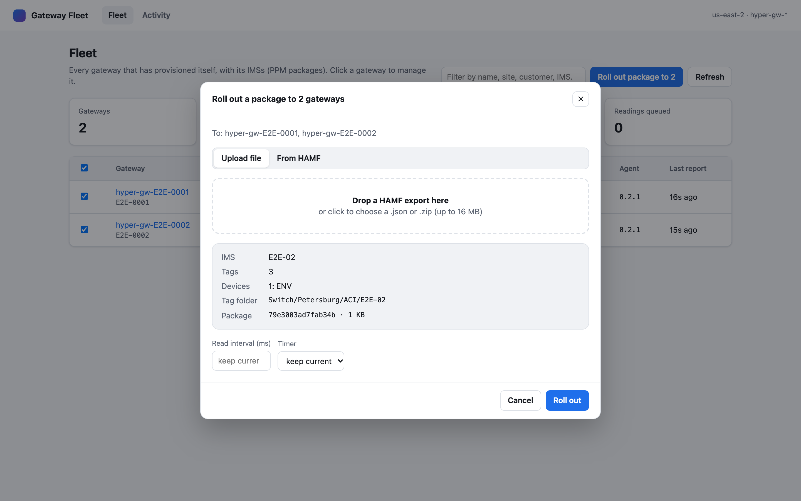

### Gateway actions

* **Pause telemetry / Resume telemetry**: the gateway keeps reading and buffering, but stops
  sending until resumed.
* **Rescan projects**: tells Ignition to reload its projects.
* **Restart Ignition**: refused unless the gateway runs with `ALLOW_REMOTE_RESTART=true`. The
  refusal is reported on the gateway's shadow.

### Decommissioning

Decommissioning:
- revokes the gateway's certificate (set INACTIVE, so it can never connect again);
- deletes its shadows;
- deletes the thing.

You have to type the gateway's name to confirm. To reuse the hardware, wipe its
`gateway-agent` volume so it provisions a new identity.

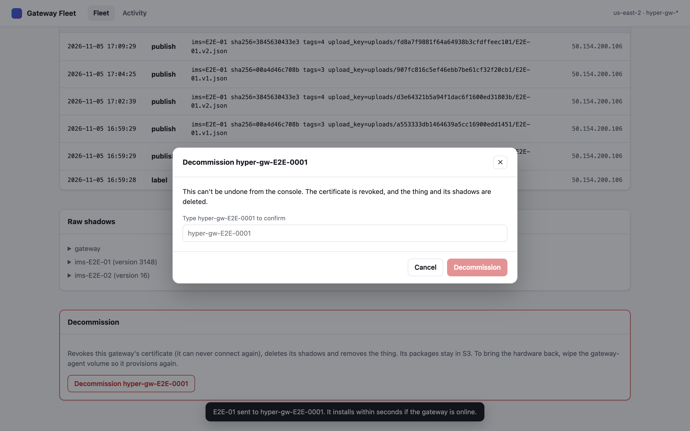

### Activity

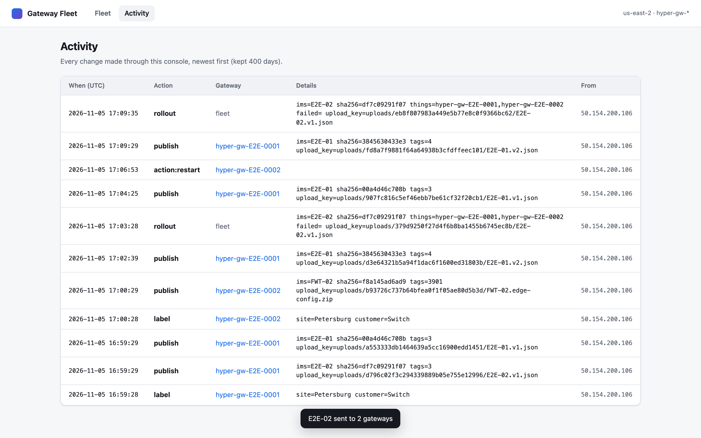

The console follows the system's light or dark theme, and works on a phone:

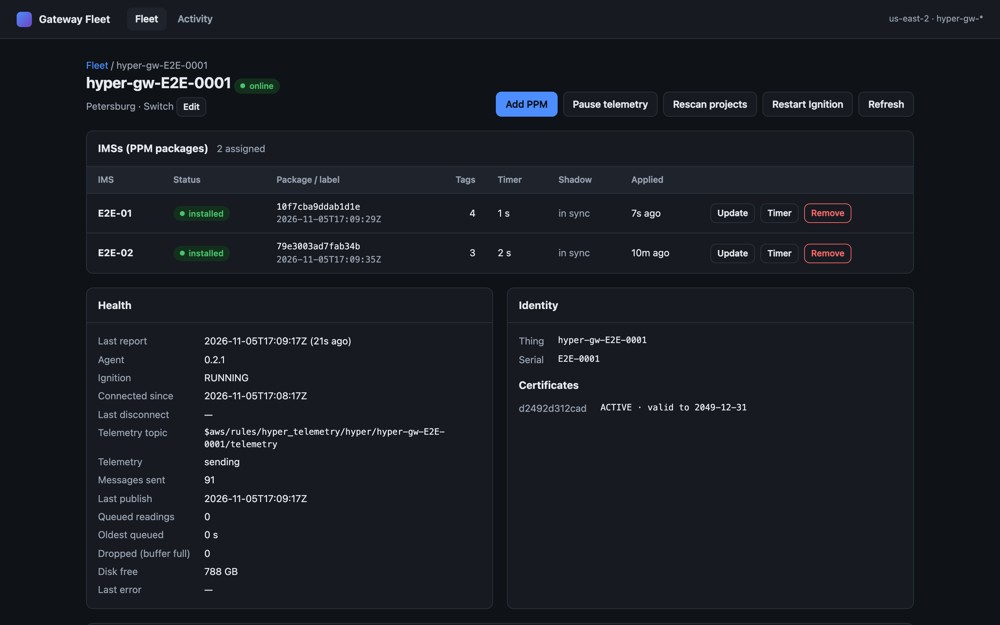

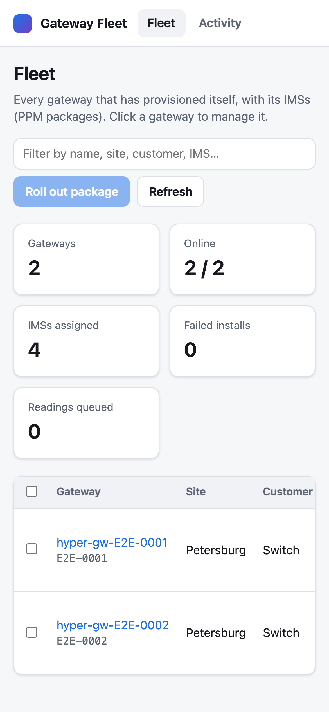

## API

All JSON, under `<console URL>/api/`. Requests that change something need `X-Console-Request: 1`.

| Method and path | Does |
|---|---|
| `GET config` | Region, thing prefix, whether HAMF pull is on, size limit |
| `GET gateways` | Fleet list with status |
| `GET gateways/{thing}` | One gateway: shadows, IMSs, certificates |
| `PATCH gateways/{thing}` | `{site, customer}` labels (thing attributes) |
| `POST gateways/{thing}/actions` | `{action}`: `pause`, `resume`, `rescan`, `restart`, `basic_ingest_on`, `basic_ingest_off` |
| `DELETE gateways/{thing}` | Decommission; body `{confirm: thing}` |
| `POST uploads` | `{filename, size}` → presigned S3 PUT `url` and `upload_key` |
| `POST preview` | `{upload_key or hamf_asset_id, thing?}` → summary, and a diff against that gateway |
| `POST gateways/{thing}/ims` | Publish: `{upload_key or hamf_asset_id, interval_ms?, enabled?}` |
| `POST rollout` | The same, with `things: [...]` (up to 100) |
| `PATCH gateways/{thing}/ims/{ims}` | `{interval_ms?, enabled?}` |
| `POST gateways/{thing}/ims/{ims}/retry` | Retry a failed install |
| `DELETE gateways/{thing}/ims/{ims}` | Remove the IMS |
| `GET hamf/hierarchy` | HAMF's asset tree (HAMF pull on) |
| `GET audit[?thing=]` | Recent activity |

`tools/publish_ims.py` still works for scripts. It delivers by presigned URL rather than MQTT,
and its uploads have no manifest, so the console can't diff against them.
